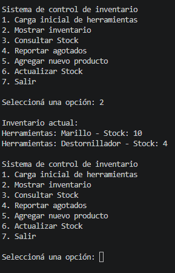

# Inventario de ferretería

Aplicación de consola desarrollada en Python para administrar
productos y controlar el stock de una ferretería.

Proyecto académico ampliado como práctica personal.

## Funcionalidades

- Carga inicial de herramientas.
- Alta de productos sin nombres duplicados.
- Consulta del inventario y del stock por producto.
- Reporte de productos agotados.
- Registro de ventas e ingresos de unidades.
- Validación para evitar stock negativo.
- Guardado y recuperación de datos en un archivo JSON.
- Mensaje de error si el archivo JSON está dañado.

## Tecnologías

- Python 3.
- Bibliotecas estándar: json y pathlib.
- Sin dependencias externas.

## Cómo ejecutar

1. Instalar Python 3.
2. Descargar el proyecto y abrir una terminal en su carpeta.
3. Ejecutar:

   python main.py

En Windows también se puede utilizar:

   py main.py

## Almacenamiento

El archivo inventario.json se crea al guardar la primera operación.
Los datos se recuperan automáticamente al iniciar el programa.

Si el archivo contiene JSON inválido, el programa informa el error
y termina sin abrir el menú.

## Limitaciones

- Interfaz de consola.
- Sin usuarios ni acceso simultáneo.
- Sin historial de movimientos: solo se conserva el stock actual.

## Captura del programa

## Autor

Nahuel Klen